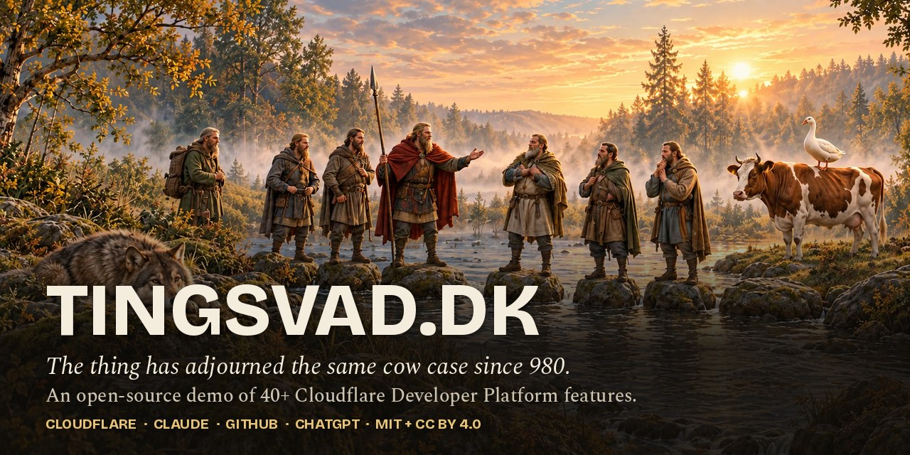

# tingsvad.dk

The ford where the thing met. The cow case is still adjourned. **Live: [tingsvad.dk](https://tingsvad.dk/) (Danish) · [tingsvad.dk/en/](https://tingsvad.dk/en/) (English)**

tingsvad.dk is an open-source, working demonstration of the Cloudflare Developer Platform, wrapped in a fictional "local history" of a Viking-age *thing* (assembly) at a river ford that has been adjourning the same case about a cow since the year 980. More than 40 Cloudflare features are in use: Workers with Static Assets (one Worker serves the whole site), Workers Builds and Worker Previews, service bindings, HTMLRewriter, Workers AI (text, vision, image generation, embeddings, text to speech and Whisper speech to text), AI Gateway, AI Search, the Web Search API, Durable Objects (WebSocket Hibernation, SQLite, jurisdictions), D1, R2, KV, Vectorize, Workflows, Queues, Cron Triggers, Workers Cache, Browser Run, Images, Realtime SFU, Web Crypto ML-DSA-65, Secrets Store, Turnstile, Cloudflare Access, Email Workers, rate limiting, Workers Analytics Engine with the Analytics SQL binding, the GraphQL Analytics API, the Radar API, Web Analytics, Workers Logs, Issues and Traces, Cloudflare Fonts, WAF and DDoS protection, DNSSEC and data jurisdictions (EU). Every page is also served as Markdown to agents (`Accept: text/markdown`), errors answer as RFC 9457 problem details, and an MCP server lets AI assistants use the thing. The full list, with a setup guide for each feature, is in [docs/CLOUDFLARE-FEATURES.md](docs/CLOUDFLARE-FEATURES.md). The colophon on the site itself (case file 24 → *How the ford is built*) explains what each part does.

**License:** code under MIT, content under CC BY 4.0 – see [LICENSING.md](LICENSING.md).

**Build your own:** [Build your own website](docs/BUILD-YOUR-OWN.md) – a guide and a start prompt for Claude · [The Cloudflare features](docs/CLOUDFLARE-FEATURES.md) – every Cloudflare feature the site uses, with a short setup guide · Claude skills in [`.claude/skills/`](.claude/skills/) · På dansk: [Byg din egen](docs/da/BYG-DIN-EGEN.md), [Cloudflare-funktionerne](docs/da/CLOUDFLARE-FUNKTIONER.md)

**Contents:** [Build it yourself](#build-it-yourself) · [Structure](#structure) · [What the site does](#what-the-site-does) · [Deploy](#deploy) · [Changelog](CHANGELOG.md) · [Security](SECURITY.md) · [License](LICENSING.md)

## Build it yourself

The core runs on a free Cloudflare account, including Queues (available on Workers Free since February 2026). A few features need Workers Paid (USD 5 a month plus usage) or AI Gateway credit: the daily audit's many subrequests, the Web Search column and higher AI volumes. For a gentler start that rebuilds the site into your own, see [docs/BUILD-YOUR-OWN.md](docs/BUILD-YOUR-OWN.md).

1. **Fork/clone** the repo. There is no build step; `index.html` is the front page.
2. **KV**: create the namespace `tingsvad-sager` and put its id in `site-worker/wrangler.toml` and in `worker/wrangler.toml`.
3. **The site Worker** (`site-worker/`): Workers & Pages → Create → Import a repository → pick the repo, set *Path* to `site-worker` (deploy command `npx wrangler deploy`, preview command `npx wrangler preview`). Or deploy by hand: `cd site-worker && npm ci && npx wrangler deploy`. The Worker serves the repo root as Static Assets; `.assetsignore` keeps everything but the site out. Change or remove the `routes` line (custom domain) and `WEB_ANALYTICS_TOKEN` for your own domain.
4. **The Worker** (`worker/`): create D1 (`npx wrangler d1 create tingsvad-ting-ai`), R2 (`npx wrangler r2 bucket create tingsvad-ting-ai-media`) and Vectorize (`npx wrangler vectorize create tingsvad-kanon --dimensions=1024 --metric=cosine`), put the ids in `worker/wrangler.toml`, run `npx wrangler d1 migrations apply tingsvad-ting-ai --remote`, set `SESSION_SECRET` with `npx wrangler secret put`, and deploy with `npx wrangler deploy`. The Durable Object and the Workflow are created on first deploy. See [`worker/README.md`](worker/README.md).
5. **Optional**: an AI Gateway named `tingsvad` (or set `AI_GATEWAY_ID = ""`), a Turnstile widget (site key in `site-worker/wrangler.toml`, `TURNSTILE_SECRET` as a secret on both Workers; for Worker Previews `npx wrangler preview base-config secret put TURNSTILE_SECRET`), Images → Transformations, Speed → Cloudflare Fonts, DNSSEC under DNS → Settings.
6. **First call** to Llama 3.2 Vision requires accepting Meta's license; see `worker/README.md` under *Known limitations*.
7. **Optional, statistics pages** (the defences, the crawlers, the speed, Denmark right now): an API token with Zone → Analytics → Read for your zone, Account → Account Analytics → Read and Account → Radar → Read, set with `npx wrangler secret put CF_ANALYTICS_TOKEN`; put your `CF_ZONE_ID`, `CF_ACCOUNT_ID` and Web Analytics `RUM_SITE_TAG` in `worker/wrangler.toml`.
8. **Optional, the archive cabinet**: create the EU-locked stores with `npx wrangler d1 create <name> --jurisdiction=eu`, `npx wrangler kv namespace create <name> --jurisdiction=eu` and `npx wrangler r2 bucket create <name> --jurisdiction=eu`, and bind them as `EU_DB`, `EU_KV` and `EU_R2` (the R2 binding with `jurisdiction = "eu"`). The Durable Object `EuSkab` is created on deploy.

The ids in the two `wrangler.toml` files are resource addresses, not secrets; they only work with a token on the account that owns them. All secrets are set with `wrangler secret put` and never live in the repo.

## Structure

- `index.html` – Danish front page; `en/index.html` – English edition
- Sub-pages (Danish · English): `historien/` · `en/history/`, `oplevelser/` · `en/experiences/` with `undersoegelsen/` · `investigation/`, `maskinparken/` · `machine-park/` and `gaestebog/` · `guestbook/` and `sagsmappen/` · `case-file/`, `arkivet/` · `en/archive/`, `maskinrummet/` · `en/machine-room/` with `noedoevelser/` · `emergency-drills/` and `revisionen/` · `audit/`
- `partials/` – shared top bar, navigation and footer (da/en); the side middleware (`functions/_lib/side.js`) inserts them with HTMLRewriter (no build step) and sets the security headers on HTML, since `_headers` only applies to responses served straight from the assets
- `assets/kanon.json` – one source for the universe's dates and rulings (read by the page and bundled into the Worker); `assets/ankre.js` – forwards old `/#fragment` links to the sub-page where the element now lives
- `protokol/`, `en/protokol/` – printable minutes (→ PDF via Browser Run)
- `assets/site.css`, `assets/site.js` – shared styles and script; `round3.js`–`round6.js` + `round5-tekst.js`/`round6-tekst.js` – features added per round, with all texts (da/en) in the `-tekst` files
- `assets/pak/` – image pack (evidence, portraits, map, seals, radio, rune stones), `assets/r/` – responsive variants (avif/webp/jpg)
- `site-worker/` – the site Worker `tingsvad-site` (round 11): `wrangler.toml` (Static Assets with `run_worker_first`, bindings, Worker Previews) and a dependency-free router (`index.js`) in front of the modules in `functions/`
- `functions/` – the request handlers, written as Pages Functions modules and run by the site Worker's router: guestbook (`api/sager.js`, KV), Turnstile site key, `/sag/:nr` share pages, proxy to the ting-ai Worker (`api/ting-ai/[[path]].js`), `/admin/*` behind Cloudflare Access, and the shared middleware in `_lib/`. The root `wrangler.toml`, `_routes.json` and the `_middleware.js` entry points keep the old Pages project working as a fallback during the move
- Machine room pages (Danish · English): `maskinrummet/kortet/` · `en/machine-room/map/` (infrastructure map), `vaernet/` · `defences/`, `crawlerne/` · `crawlers/`, `hastigheden/` · `speed/`, `danmark/` · `denmark/`, `arkivskabet/` · `archive-cabinet/` and `doeren/` · `the-door/` (Zero Trust and the Access-locked admin door), drawn by `assets/infrakort.js`, `assets/vagt.js`, `assets/maaling.js`, `assets/arkivskab.js` and `assets/doeren.js`
- `mcp/` – the MCP server `tingsvad-mcp` on `mcp.tingsvad.dk` (its own Worker)
- `docs/` – [Build your own](docs/BUILD-YOUR-OWN.md) and [the Cloudflare features](docs/CLOUDFLARE-FEATURES.md), with Danish editions in `docs/da/`; `.claude/skills/` – Claude skills for rebuilding the site (`build-your-own-site`, `image-prompts`, `cloudflare-setup`)
- `.assetsignore` – everything that is not the site (Worker code, tests, docs, config) stays out of the published assets
- `worker/` – the Worker `tingsvad-ting-ai` (D1, R2, KV, Durable Objects, Workflows, Queues, Cron, Workers AI, AI Search, Vectorize, Browser Run, Images, Realtime SFU, Workers Cache, rate limiting, and the hourly collection from the GraphQL Analytics and Radar APIs)
- `sw.js`, `manifest.webmanifest` – offline and "add to home screen"
- `_headers` – security headers (CSP, HSTS), cache rules; `robots.txt`, `sitemap.xml`, `llms.txt`
- `bump.sh` – updates the `?v=` cache-busting hashes in every page after changes to css/js/kanon.json; `build-images.py` – regenerates responsive images (`pip install pillow pillow-avif-plugin`); `build-og.py` – makes the 1200×630 share image (og:image) for every page from its own painting and title, and points the page's meta tags at it (`python3 build-og.py --fonts <dir>`, see the script for the fonts)

## Deploy

Push to `main`; Workers Builds deploys the site Worker (`site-worker/`) automatically, and every other branch gets a Worker Preview with its own KV, Analytics Engine dataset and the `tingsvad-ting-ai-preview` Worker. The ting-ai Worker (`worker/`) and the MCP server (`mcp/`) are deployed by hand with `npx wrangler deploy`. Run `./bump.sh` after editing css/js so browsers fetch the new files.

## Tests

- `worker/test/` – unit tests for the ting-ai Worker (`cd worker && node --test test/*.test.js`).
- `site-worker/test/` – unit tests for the site Worker's router (`cd site-worker && npm test`).
- `tests/` – quality tests against a published address: Playwright in Chromium, Firefox and WebKit, desktop and mobile, with axe-core and Lighthouse CI. Run automatically by GitHub Actions after each push to `main` or `runde-9`, once the site Worker (or its Worker Preview) serves that commit; see [tests/README.md](tests/README.md).

## What the site does

- **Front page** (24 "case files"): the painting of the thing with a time machine (980–2026), parallax, day/night light, generative river and wind audio, the minutes with Denmark and AI history, family tree, Gudrun's ledger, guestbook ("raise a case", stored in KV), fog forecast with the stone button *Summon the fog*, certificate generator, Younger Futhark transliterator, runic stick, horoscope, radio, 15 "investigation" features (redacted documents, turn the shield, excavation, the missing page 2, notice board, queue ticket, fog camera, museum, seasons, stool configurator, expert panel, emergency plan, imprecise measurements, search in the fog), and factual "What we actually know" boxes with sources.
- **The thing's machine park** (`#paafund`, backed by the Worker; formerly "eight new contrivances"): an AI courtroom, a shared seven-seat vote (Durable Object + WebSocket), a daily generated newspaper (Cron), image evidence (vision model), a fictional-find generator (image model, R2), a stool application processed over days (Workflow), Mímir's hint archive (Vectorize) and a radio broadcast (TTS for the English edition). All AI output is validated against a schema, labelled as fiction, and never decides the cow case. Without the Worker binding the panels show clearly labelled editorial examples.
- **The machine room** (the colophon, not fiction): how the site is built, with a live architecture diagram, Gudrun's daily audit of every page, emergency drills, and six live pages: the infrastructure map (which data centre answered you, where the database and Durable Objects live), the defences (attacks Cloudflare blocked, on a world map), the crawlers (search engines and AI bots, what they read), the speed (Core Web Vitals from real guests), Denmark right now (Cloudflare Radar for Denmark next to the thing's own figures) and the European archive cabinet (D1, KV, R2 and a Durable Object locked to the EU, measured live, next to an unlocked object).
- **Hidden things**: type `ko` (cow) anywhere, press "Ask Mímir" 10 and 100 times, the Konami code, print the page.

## Credits

- **Jan Tingsvad** – idea, universe, texts, direction, the Cloudflare setup, and the thing's minutes.
- **ChatGPT (OpenAI)** – all the graphics: the paintings, portraits, evidence images, map, seals, the raven, the fog, the stone button and the reclining developer, generated from written briefs, plus the build packs that describe each image's placement.
- **Claude (Anthropic)** – pair programmer: HTML/CSS/JS, the Worker code and the documentation, from the same build packs, and a guide through the Cloudflare setup. Each round is documented in [CHANGELOG.md](CHANGELOG.md).

Every fact box on the site is sourced; everything else is fiction and says so.
